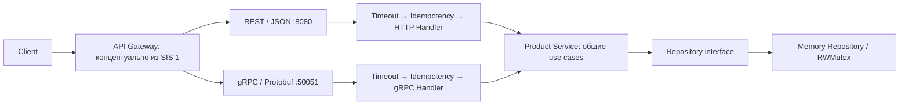

# SIS #2 — Product Catalog Service

Рабочий каталог на Go: REST/JSON и gRPC/Protobuf используют один сервис и один потокобезопасный in-memory repository. PostgreSQL, Redis и Elasticsearch не запускаются. Исходная схема и расчёты SIS #1 сохранены в `SIS1.excalidraw`.

## Быстрый запуск

Требуется Go **1.22+**. Для обычного запуска достаточно Go и доступа к Go modules при первом скачивании зависимостей. Сгенерированные protobuf-файлы уже включены в `gen/`; `protoc`, Docker и внешние БД не нужны.

```shell
go mod download
go run ./cmd/app
```

Сервер слушает HTTP на `:8080`, gRPC на `:50051`. Остановка — `Ctrl+C`: HTTP Shutdown и gRPC GracefulStop с общим бюджетом 5 секунд, затем принудительное завершение оставшихся соединений. Порты должны быть свободны. При ошибке bind приложение освобождает уже открытый listener и завершает запуск с ошибкой.

При старте: **10 категорий**, **20 товаров**, **1 бренд**. Все товары находятся в `cat-01`, чтобы сразу проверять страницы по 3/5/20 товаров; `cat-02`…`cat-10` существуют и первоначально пусты. Товары: `product-01`…`product-20`, бренд: `brand-01`. Это допустимые строковые ID. Новые товары получают UUID v4 из `crypto/rand`.

Данные и ключи идемпотентности живут в памяти процесса и исчезают после перезапуска. HTTP и gRPC работают без TLS для локальной лабораторной.

## Архитектура



API Gateway показан как граница архитектуры SIS #1; отдельный gateway-процесс в лабораторной не реализован. Можно обращаться прямо к обоим серверам. Поиск, дерево категорий отдельным endpoint, CDN, авторизация и outbox не входят в четыре use case SIS #2.

Зависимости направлены внутрь: domain ничего не знает о сети; service зависит от domain и объявленного у потребителя интерфейса Repository; memory реализует этот интерфейс; transport преобразует данные и ошибки; `main` соединяет зависимости явно. Ни HTTP, ни gRPC не обращаются к map напрямую.

Структура соответствует распространённому Go layout, который является соглашением сообщества, а не обязательным стандартом языка:

```text
cmd/app/main.go                        сборка зависимостей, listeners, shutdown
cmd/measure/main.go                    воспроизводимый замер размера и latency
proto/product.proto                    контракт четырёх RPC
gen/product/v1/*.pb.go                  официальный сгенерированный код
internal/domain/product.go             модели, частичные изменения, типизированные ошибки
internal/repository/memory_repo.go     maps, RWMutex, SKU и индекс категории
internal/service/product_service.go    валидация, UUID, курсоры, PATCH
internal/idempotency/cache.go          общий алгоритм TTL и объединения повторов
internal/transport/rest/handler.go     JSON и HTTP-маршруты
internal/transport/rest/middleware.go  буферизация, 80 ms, идемпотентность
internal/transport/grpc/handler.go     преобразование protobuf ↔ domain
internal/transport/grpc/interceptors.go тайм-аут и идемпотентность RPC
internal/client/grpc_client.go         безопасные retries с backoff и jitter
scripts/benchmark_rest.js              k6 constant-arrival-rate
scripts/benchmark_grpc.sh              ghz с заданным RPS
scripts/generate.ps1, generate.sh      воспроизводимая генерация
examples/create.json                  тело запроса создания
docs/benchmark.json                   исходные результаты реального замера
```

В написанном вручную коде нет изменяемых глобальных переменных и вызовов `panic()`. Поэтому доменные ошибки — экземпляры `*domain.Error` с полем Kind, а не пакетные `var Err…`. Стандартный код генераторов в `gen/` содержит служебные глобальные protobuf-дескрипторы и `init`: это часть механизма регистрации protobuf, его не следует переписывать вручную. `const` не являются изменяемым глобальным состоянием.

## API и демонстрация

| REST | RPC | Результат |
|---|---|---|
| `GET /v1/products/{id}` | `GetProduct` | карточка товара |
| `GET /v1/categories/{id}/products?cursor=&limit=20` | `ListCategoryProducts` | `products`, `next_cursor` |
| `POST /v1/products` | `CreateProduct` | новый товар, version=1 |
| `PATCH /v1/products/{id}` | `UpdateProduct` | частичные изменения и version+1 |

Все поля Product из задания сохранены. `updated_at` в REST — UTC RFC3339Nano, в protobuf — `google.protobuf.Timestamp`. HTTP возвращает обычные JSON numbers; protobuf JSON tooling отображает int64 (например version) строкой по правилам ProtoJSON, хотя на проводе это бинарный varint.

### PowerShell: REST

В первом терминале запустить сервер, во втором:

```powershell
$base = 'http://localhost:8080'
Invoke-RestMethod "$base/v1/products/product-01"
$page = Invoke-RestMethod "$base/v1/categories/cat-01/products?limit=3"
$page.products
Invoke-RestMethod "$base/v1/categories/cat-01/products?limit=3&cursor=$($page.next_cursor)"

$body = Get-Content -Raw examples/create.json
$headers = @{'X-Idempotency-Key' = 'demo-rest-1'}
$created = Invoke-RestMethod -Method Post -Uri "$base/v1/products" -Headers $headers -ContentType 'application/json' -Body $body
$replayed = Invoke-RestMethod -Method Post -Uri "$base/v1/products" -Headers $headers -ContentType 'application/json' -Body $body
$created.id -eq $replayed.id

$patch = @{version = $created.version; price = 0; in_stock = 0} | ConvertTo-Json
Invoke-RestMethod -Method Patch -Uri "$base/v1/products/$($created.id)" -ContentType 'application/json' -Body $patch
# Повтор с прежней version должен вернуть 409:
Invoke-RestMethod -Method Patch -Uri "$base/v1/products/$($created.id)" -ContentType 'application/json' -Body $patch
```

POST возвращает **201 Created**, тело Product и `Location: /v1/products/{UUID}`. Повтор возвращает те же status, headers и body, включая исходный `updated_at`. Для успешного следующего изменения сначала прочитайте актуальный товар и используйте его version. Повторное создание того же SKU с другим ключом конфликтует.

### gRPC через grpcurl

Сервер включает reflection. Установить grpcurl отдельно; команды с `-d @` читают JSON из stdin и подходят для PowerShell без проблем экранирования кавычек:

```powershell
grpcurl -plaintext localhost:50051 list
'{"id":"product-01"}' | grpcurl -plaintext -d @ localhost:50051 catalog.v1.ProductService/GetProduct
'{"category_id":"cat-01","limit":3}' | grpcurl -plaintext -d @ localhost:50051 catalog.v1.ProductService/ListCategoryProducts
Get-Content -Raw examples/create.json | grpcurl -plaintext -H 'idempotency-key: demo-grpc-1' -d @ localhost:50051 catalog.v1.ProductService/CreateProduct
```

Для создания по обоим протоколам в одном запуске поменяйте SKU в JSON: он уникален в общем repository. Для проверки replay gRPC повторите последнюю команду с тем же телом и metadata.

UpdateProduct принимает вложенное `changes`; в REST поля изменений находятся рядом с version:

```json
{
  "id": "product-01",
  "version": "1",
  "changes": {
    "price": 0,
    "in_stock": 0,
    "attributes": {"values": {}},
    "images": {"values": []}
  }
}
```

В REST аналогичное тело: `{"version":1,"price":0,"in_stock":0,"attributes":{},"images":[]}`. Отсутствие поля означает «оставить прежнее», явное нулевое значение означает «установить ноль», пустая коллекция — «очистить». REST `null` для полей изменений трактуется как отсутствие; для очистки нужны `{}` или `[]`. Это собственный JSON PATCH-контракт, не RFC 6902 JSON Patch и не RFC 7396 Merge Patch.

`id`, `version`, `updated_at` нельзя задавать при создании, а `id` и `updated_at` нельзя менять через PATCH. Устанавливать ID из path и версию отдельно безопаснее, чем принимать полную модель Product от клиента.

### Валидация и ошибки

Обязательны непустые SKU, title, category_id, brand_id; категория и бренд должны существовать. Цена конечная и ≥0; остаток ≥0. Пределы: SKU 128 байт, title 512, description 16384, идентификаторы ссылок 128; до 100 атрибутов и 20 URL изображений; ключ атрибута ≤128, значение ≤1024, URL ≤2048. Цена 0 допустима. `NaN`/`Inf` из gRPC отклоняются явно.

REST ограничивает тело 1 MiB, отклоняет неизвестные поля и несколько JSON-значений в одном теле. Слишком большое тело в этом контракте возвращает 400. gRPC ограничивает сообщение 1 MiB; транспортный лимит gRPC может вернуть ResourceExhausted до handler. Коллекции при изменении заменяются целиком. Нельзя отправить PATCH без изменений. PATCH требует положительную version, которую можно увеличить без переполнения int64.

| Ситуация | HTTP | gRPC |
|---|---|---|
| Некорректные данные/ключ/курсор | 400 | InvalidArgument |
| Товар или категория отсутствует | 404 | NotFound |
| Устаревшая version, занятый SKU, другой запрос с тем же ключом | 409 | Aborted |
| Истёк deadline | 504 | DeadlineExceeded |
| Родительский context отменён | 408, если ещё возможно ответить | Canceled |
| Кеш идемпотентности заполнен | 503 | Unavailable |
| Неожиданная внутренняя ошибка | 500 | Internal |

HTTP-ошибки имеют вид `{"error":"…"}`. Внутренние ошибки логируются, технические детали клиенту не раскрываются. При закрытом клиентском соединении никакой код уже не гарантирует доставку ответа.

### Курсорная пагинация

Сортировка — лексикографический `id ASC`. Курсор содержит последнюю ID и категорию в base64url JSON; клиент должен считать его непрозрачным. Сервис проверяет кодировку, принадлежность категории и ограничивает длину 2048 байт. `limit=0` или отсутствие → 20; допустимо 1…100. Последняя страница возвращает `next_cursor: ""`, пустая категория — `products: []`. Несуществующая категория — 404.

Repository хранит отсортированный индекс `category -> []id` и ищет первую ID > cursor через `sort.Search`. Чтение страницы — **O(log N + limit)** для N товаров категории, с дополнительной стоимостью копирования полей. Вставка/перенос товара требует O(N) сдвига среза; это осознанный компромисс для read-heavy лабораторной. Offset и пересортировка всех товаров на каждом GET не используются.

Пагинация не фиксирует snapshot: конкурентные вставки до курсора могут не попасть в текущий обход, перемещения между категориями также меняют состав. Курсор не подписан и не является средством авторизации. В production сортировка и курсор должны соответствовать составному индексу БД, например `(category_id, price, id)` из SIS #1.

## Надёжность

### Идемпотентность

1. Только создание требует ключ: HTTP `X-Idempotency-Key`, gRPC metadata `idempotency-key`. Допустим один непустой ключ длиной до 128 байт.
2. Middleware/interceptor вычисляет SHA-256 запроса. REST сравнивает **байты тела**, поэтому другие пробелы или порядок полей требуют нового ключа. gRPC использует deterministic protobuf marshaling, включая стабильный порядок map.
3. Под коротким mutex кеша создаётся запись с `done chan struct{}`. Только её владелец вызывает следующий handler и service. Конкурентные повторы ждут закрытия done, учитывая собственный context; другой fingerprint сразу получает конфликт.
4. Успешный результат сохраняется на **10 минут с момента завершения**. HTTP хранит неизменяемый буфер status/headers/body, gRPC — protobuf-копию; каждому RPC replay возвращается отдельный clone.
5. Ошибки передаются текущим ожидающим запросам, но удаляются из кеша, чтобы временный сбой можно было повторить. Успех кешируется и тогда, когда внешний HTTP/RPC timeout уже лишил исходного клиента ответа.
6. До **10 000 записей на транспорт**, включая выполняющиеся. Истечение TTL проверяется при обращении; при заполнении удаляются просроченные записи. Нет фонового ticker и утечек janitor-goroutine. Просроченные данные могут физически оставаться в ограниченном map до следующего обращения. При отсутствии места — 503/Unavailable, живые записи не вытесняются.

Кеши принадлежат транспортам; одинаковая строка ключа в REST и gRPC — разные пространства. Не переключайте протокол при повторе создания. Общая уникальность SKU проверяется независимо. После TTL или рестарта гарантии replay нет. Это не распределённое exactly-once: несколько инстансов потребуют общего idempotency store и атомарной связи результата с записью товара. В авторизованном API ключ также нужно привязать к tenant/user. Ограничение числа записей ограничивает количество объектов, а не фиксированный объём RAM в байтах.

### Тайм-аут 80 ms

HTTP middleware и gRPC interceptor создают `context.WithTimeout(parent, 80*time.Millisecond)` и всегда вызывают cancel. Более ранний клиентский deadline сохраняется. Context передаётся через каждый слой до repository; сервис явно проверяет `select { case <-ctx.Done(): …; default: … }`, repository проверяет `ctx.Err()` до и после получения mutex и внутри обхода страницы.

HTTP worker пишет только в собственный буфер; основной handler выбирает между готовым результатом и `ctx.Done()`, поэтому поздний worker не пишет в уже завершённый ResponseWriter. По истечении бюджета формируется 504. gRPC deadline клиента контролирует транспорт; серверный interceptor ограничивает context и переводит отмену в DeadlineExceeded после возврата кооперативного handler.

`Context` не убивает goroutine и не прерывает `RWMutex.Lock` автоматически. Поэтому критические секции короткие, без сетевого I/O. Для будущей БД нужны context-aware драйверы. Тайм-аут — бюджет работы после входа в middleware, не гарантия real-time планировщика, доставки по сети или p99: HTTP parsing, сеть, перегрузка и gateway тоже потребляют время. HTTP server дополнительно ограничивает чтение заголовков 2 s, чтение запроса 5 s и запись 1 s.

Отмена не откатывает уже завершённую запись. Если commit прошёл перед deadline, клиент может получить timeout, хотя товар создан; тот же idempotency key позволяет получить сохранённый успешный результат. После PATCH без кеша результата нужно перечитать товар и разобраться с его version.

### gRPC retries

`internal/client/grpc_client.go` предоставляет `client.New(target)` → generated client, connection, error. Закрыть connection обязан вызывающий код. Вызывающий код также задаёт общий клиентский deadline; backoff и все попытки входят в этот общий бюджет.

До **трёх попыток всего**, то есть исходная и максимум две повторные. Повторяем только `codes.Unavailable`: HTTP 503, пришедший от HTTP/2 intermediary без gRPC status, отображается gRPC в Unavailable. Число `503` не является gRPC status code; анализировать строки ошибок или приводить `codes.Code(503)` неверно.

Backoff: потолок `5ms * 2^attempt`, full jitter равномерно от 0 до потолка: перед вторым вызовом [0,5ms), перед третьим [0,10ms). Ожидание через timer+select прерывается context. `math/rand/v2` достаточно для jitter; UUID использует криптографический генератор. Встроенные retries соединения выключены через `WithDisableRetry`, чтобы не складывать их с явным циклом.

Повторяются GET/list и CREATE с сохранённым ключом. UPDATE автоматически не повторяется: ответ об успешном PATCH мог потеряться, а повтор с той же версией вернёт конфликт. DeadlineExceeded, InvalidArgument, Aborted и остальные ошибки не ретраятся. Запрос и metadata должны оставаться неизменными между попытками.

Официальное описание поведения и безопасности повторов: [gRPC Retry](https://grpc.io/docs/guides/retry/), [gRPC status codes](https://grpc.github.io/grpc/core/md_doc_statuscodes.html), [HTTP → gRPC status mapping](https://grpc.github.io/grpc/core/md_doc_http-grpc-status-mapping.html).

## Реальные измерения

Исходный отчёт — [`docs/benchmark.json`](docs/benchmark.json). Измерено **30 октября 2026**, Windows amd64, Intel Core i5-10500H 2.50 GHz, 12 логических CPU, Go 1.25.4. Сервер и измеритель — отдельные собранные процессы на одном компьютере, loopback, без TLS/компрессии. Данные — стартовый seed; это не 4 KiB карточки и не миллион товаров из целевой архитектуры SIS #1.

### Размер payload

| Ответ | REST JSON, байт | Protobuf, байт | Сокращение тела |
|---|---:|---:|---:|
| 1 товар, GetProduct | 362 | 214 | 40,9% |
| 20 товаров, ListCategoryProducts | 7 294 | 4 348 | 40,4% |

REST измеряется по фактически полученному телу, включая завершающий newline; protobuf — `proto.Size` полученного ответа. Список включает envelope (`products`/`next_cursor` и protobuf message). HTTP headers, HTTP/2 framing, gRPC prefix 5 байт, TCP/IP и TLS сюда не входят. Это размеры **тел**, а не суммарного трафика.

### Latency при 3 000 RPS

| Протокол | Предложенная нагрузка | Запросов / ошибок | Завершений в секунду | p50, ms | p95, ms | p99, ms |
|---|---:|---:|---:|---:|---:|---:|
| REST | 3 000 RPS | 30 000 / 0 | 3 000,06 | 0,294 | 0,591 | 0,709 |
| gRPC | 3 000 RPS | 30 000 / 0 | 2 999,93 | 0,285 | 0,564 | 0,656 |

Для каждого протокола: 200 warmup-запросов, затем **10 секунд**, 128 workers, GET одной карточки `product-01`. REST использует persistent HTTP/1.1 соединения, gRPC — одно HTTP/2 connection с multiplexing. Протоколы измерялись последовательно. Retries при измерении выключены. Завершений в секунду рассчитано по фактическому времени от запуска расписания до окончания всех запросов; поэтому возможны небольшие отклонения от 3 000.

Измеритель задаёт open-loop расписание: плановое время запроса не зависит от завершения предыдущего. Latency отсчитывается **от запланированного времени**, включая очередь и задержку генератора; это уменьшает coordinated omission. Перцентили nearest-rank считаются по всем запросам, ошибки учитываются отдельно. При перегрузке нужно смотреть одновременно errors, фактический throughput и перцентили.

Это короткий локальный sanity benchmark, а не доказательство SLA, максимального RPS или преимущества CPU одного протокола. Для защиты допустимо утверждать лишь, что данный запуск на данном стенде удовлетворил p99 < 80 ms. Для production нужны длительные независимые прогоны на отдельном load generator, реальные payload/сеть/TLS, смешанные чтения/записи 500:1, большой каталог и профили CPU/allocations.

Воспроизведение: в первом терминале запустить собранный сервер, во втором измеритель:

```powershell
go build -o bin/catalog.exe ./cmd/app
go build -o bin/measure.exe ./cmd/measure
.\bin\catalog.exe
```

```powershell
.\bin\measure.exe -rate 3000 -duration 10s -workers 128
# Для сохранения нового отчёта:
.\bin\measure.exe -rate 3000 -duration 30s -workers 128 | Set-Content -Encoding utf8 new-benchmark.json
```

На Linux/macOS можно запускать `go run ./cmd/app` и `go run ./cmd/measure -rate 3000 -duration 10s`; для стабильного сравнения предпочтительны заранее собранные бинарные файлы. Перед измерением перезапустите сервер, чтобы восстановить неизменный seed.

Дополнительно включены стандартные сценарии. Установить k6/ghz отдельно:

```shell
k6 run scripts/benchmark_rest.js
bash scripts/benchmark_grpc.sh
```

k6 использует constant-arrival-rate, выводит p50/p95/p99, проверяет p99<80ms, ошибки<1%, отсутствие dropped iterations. ghz запускается с `--rps 3000`, 128 concurrent workers, 1 connection, 30 s. Их определения latency и поведение при перегрузке могут отличаться от `cmd/measure`; результаты README получены именно `cmd/measure`, а не выданы за прогоны k6/ghz. `benchmark_grpc.sh` запускается в Bash, в Windows — например Git Bash.

## Аргументация выбора протокола

**REST** удобен для публичного API: привычные HTTP status, браузеры, curl, прокси, observability и кеширование на gateway/CDN. JSON читается человеком, но передаёт имена полей и требует текстового кодирования чисел/декодирования объектов.

**gRPC** удобен между сервисами: строгий `.proto` контракт, генерируемые клиенты, protobuf binary, metadata и deadlines. Меньшее тело и отсутствие текстового JSON-маршалинга могут сократить CPU и bandwidth; это зависит от данных и реализации. В данном проекте измерено уменьшение тела, а экономию CPU нужно отдельно подтверждать pprof: latency сама по себе её не доказывает. HTTP/2 позволяет мультиплексировать RPC в одном соединении. Возможны расходы на адаптацию domain/protobuf и сам gRPC runtime.

**WebSocket** не выбран: при чтениях 500:1 и независимых stateless-запросах нет потребности в постоянном двустороннем push-канале. Поддержка долгоживущих соединений и собственного протокола сообщений усложнила бы решение; HTTP keep-alive и HTTP/2 уже переиспользуют TCP-соединения, поэтому аргумент не в том, что «только WebSocket держит TCP».

## Проверки

```shell
go test ./...
go test -race ./...
go vet ./...
go build ./...
```

Все эти проверки выполнены успешно на Go 1.25.4; дополнительно `go test ./...` выполнен на **Go 1.22.12**, чтобы проверить минимальную заявленную версию. Для `-race` нужен поддерживаемый C compiler/CGO; на данном Windows-стенде использован gcc. Обычная сборка приложения не требует CGO.

Тесты проверяют реальные конкурентные сценарии и контракты:

- REST: 24 одновременных POST с одним ключом → одинаковые 201/body/Location и ровно 1 товар; изменение тела → 409.
- REST: валидация JSON, нулевые поля PATCH, устаревшая version, истечение 80ms без поздней записи в сетевой writer.
- Service: 32 одновременных PATCH version=1 → ровно 1 успех; пагинация без дублей, запрет чужого курсора, перенос между категориями.
- Repository через use cases: изменение полученных map/slice не меняет сохранённый товар; отменённый context прекращает чтение.
- Idempotency cache: TTL, лимит, повтор после ошибки и отмена ожидающего клиента без второго вызова функции.
- gRPC: настоящий клиент и сервер через `bufconn`, конкурентный replay, metadata, list, PATCH, mapping ошибок и клиентский deadline.
- Client: три попытки только для разрешённых методов/ошибок, отсутствие retry у PATCH и отменённого запроса.

## Повторная генерация Protobuf

Зафиксированные инструменты: protoc **27.2**, protoc-gen-go **v1.34.2**, protoc-gen-go-grpc **v1.4.0**. Runtime-зависимости и транзитивные версии зафиксированы в `go.mod`/`go.sum` и совместимы с Go 1.22. Они выбраны для воспроизводимости, это не заявление о самых новых версиях библиотек.

Установить protoc с well-known includes, затем:

```powershell
.\scripts\generate.ps1
```

```shell
bash scripts/generate.sh
```

PowerShell-скрипт также умеет использовать локальный protoc из `.tools/protoc/`. Генераторы устанавливаются в `.tools/bin`; директория инструментов и `bin/` исключены из git. `gen/*.pb.go` входят в сдаваемый исходный проект. Ручные правки делаются в `.proto`, затем выполняется генерация.
